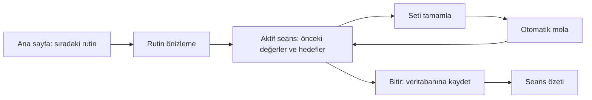
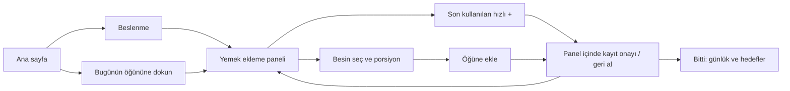

# Kullanıcı yolculukları ve etkileşim verimliliği

> **Derin inceleme notu (18 Ekim 2026):** Bu raporun düzeltilen iddiaları için bkz. [review/00_SYNTHESIS.md](review/00_SYNTHESIS.md) "Diğer raporlara düzeltmeler".

18 Ekim 2026 · kaynak `07104d1` · ilgili bulgular: [mevcut deneyim denetimi](02_CURRENT_STATE_AUDIT.md). Yolculuklar uygulamadaki gerçek rotalar ve callback'lerden çıkarılmıştır. Ekip 76 güncel widget görüntüsü ve mevcut testlerle davranış kontrolü sağladı; gerçek telefonda süre/dokunma sayımı veya kullanıcı deneyi yapılmadı.

## Sayım sözleşmesi

**Dokunuş**, aşağıdaki koşullarda kodun gerektirdiği açık bir eylem seçimidir. Uygulamayı işletim sisteminden açma, kaydırma, metin yazma tuşları, izin/OAuth pencereleri, bekleme ve klavyeyi kapatma sayılara dahil değildir. Bu nedenle “2 dokunuş” uçtan uca görev süresi veya fiziksel dokunma sayısı iddiası değildir. Başlangıç ekranı, verinin hazır olması ve hedef kontrolün görünür olması koşuldur. Scroll sayısı ve parmak erişimi gerçek cihazda **bilinmiyor**. Tasarım sonrası sayılar hedeflenen prototip sözleşmesidir, uygulanmış sonuç değildir.

## A — Antrenman başlat → set → mola → tamamla

**İş:** “Ne yapacağımı biliyorum; önceki değerlerimle hızlı kayıt istiyorum.”

Mevcut akış:

| Parça | Ekran/değişim | Kaynaktan belirlenimci seçim | Karar ve mevcut geri bildirim | Sürtünme / kanıt |
|---|---|---|---|---|
| Başlangıç | Home → önizleme → aktif | **2** | Rutin uygun mu, sonra Başla | Tanıdık rutinde aracı ekran U08; `home_screen.dart:342`, `routine_preview_screen.dart:75` |
| Antrenman sekmesinden | Home → Antrenman → rutin → önizlemeden başlat | **3** | Rutin seçimi | Doğrudan Home yolu zaten daha kısa; `workout_list_screen.dart:570` |
| Hazır öneriyi kabul | Aktif seans içinde | **1/set** | ✓, boş değerleri öneriyle doldurur; dokunsal tepki; set ilerlemesi | Öneri varsa ve uygunsa geçerli; ilk kez yapılan harekette sayı girişi gerekir. `active_session_screen.dart:604` |
| Değeri değiştir | Aynı seans | **Bilinmiyor** | Kilo/tekrar, isteğe bağlı zorluk; ± artış seçimi | Klavye, basamak, cihaz genişliği ve girilen sayıya bağlı |
| Mola | Aynı ekran ve kilit yüzeyi | Başlamak için **0** | Set tamamlanınca `restSec>0` ise otomatik; −15/+15/Atla ayrı isteğe bağlı seçim | Üstte bant; yorgun elde erişim testi gerekir. `active_session_screen.dart:620`, `:1062` |
| Hareket ekle | Aktif → seçim kütüphanesi → aktif | Görünür bir hareket için **2** (Ekle + satır) | Tek hareket seçimi; filtre/arama isteğe bağlı | Çoklu seçimin getirisi henüz ölçülmedi. `active_session_screen.dart:768`, `exercise_library_screen.dart:251` |
| Bitir | Aktif → özet | **1** | En az bir set verisi yoksa mesaj; transaction kaydı; başarısızsa taslak kalır | Bitir üst sağda; önerilen alt seans denetimi şart değil ama erişim testi adayı. `active_session_screen.dart:899`, `:932`, `:944` |

Koşullu örnek: Home'da rutin hazır; tek bir geçerli set önerisi var; kullanıcı yalnız o seti tamamlayıp bitiriyor. Home→preview→başlat→✓→Bitir = **4 kaynak tanımlı seçim**, 4 görünüm (Home/preview/aktif/özet). **Tam N setlik** seansın yalnız bu aynı yolunda, arama/giriş/isteğe bağlı kontroller hariç **N+3** seçim vardır; bunu ortalama egzersiz davranışı diye yorumlamamak gerekir.

**Önerilen akış:** Home'da gerçek Başlat → aktif → mevcut tek ✓/otomatik mola → Bitir/özet. Rutin bilgisi ayrı açık bağlantı olarak kalır. Başlangıç parçası 2→1 seçim; tek set koşullu örnek 4→3. RPE'yi zorunlu yapma, her sette yeni modal açma, tamamlanmayı kutlamak için yolu kesme. U04 için daha büyük gerçek hit alanı, önceki/önerilen/girilen değer ayrımı korunur.

**Başarı ölçümü:** İlk geçerli sete ulaşma süresi, yanlış rutin açma, set düzeltme sayısı, hedefin anlaşılırlığı, tek elle ✓ başarısı. İlk kez rutin yapan ve aynı rutini tekrar eden kullanıcı ayrı incelenir. Dokunma azalırken yanlış başlangıç artarsa öneri başarısızdır.

## B — Öğün kaydet → tüketimi ve kalan hedefi anla

**İş:** “Yediğimi hızla kaydedeyim; günün neresinde olduğumu göreyim.”

| Desteklenen yol | Kaynak tanımlı seçim | Girdi/karar | Kanıt ve yorum |
|---|---|---|---|
| Home → Beslenme → Yemek Ekle → satırdaki hızlı + | **3** ile kalıcı kayıt; **4** ile Bitti sonrası günlük | Önceki/standart porsiyonu kabul; öğün varsayılanını kontrol et | `nutrition_screen.dart:179`, `add_food_sheet.dart:516`, `:1023`, `:597` |
| Home → Beslenme → Yemek Ekle → satır → porsiyon Ekle | **4** ile kalıcı kayıt; **5** ile Bitti sonrası günlük | Besin ve porsiyon; sayı değiştirme tuşları dahil değil | `add_food_sheet.dart:522`, `:1384` |
| Home'da dört öğünden biri → hızlı + | **2** ile kayıt; **3** ile Home'a dönüş | Öğün önceden belirlenir | `today_meals_card.dart:141`; kontrolün görünmesi için gereken kaydırma bilinmiyor |
| Home alışılmış öğün önerisi → Ekle | **1** ile önerilen öğün kaydı | Kullanıcı doğru tekrarı kabul eder | Yalnız öneri oluşmuş ve görünürse; yeni özellik gerekmiyor. `nutrition_habit_widgets.dart:148` |
| Dün/geçmiş gün kopyala | Toplam **bilinmiyor** | Tüm gün veya belirli öğün, gün/porsiyon/çıkarma | Mevcut yetenek; seçili gün ve ihtiyaç farklı. `nutrition_screen.dart:274`, `meal_copy_sheet.dart:230` |
| Barkod / internet araması | Toplam **bilinmiyor** | Kamera izni, ürün bulunurluğu, ağ, porsiyon | Uygulama içinde tarama kısayolu zaten görünür; sistem adımlarını uydurma |

Mevcut panel ekledikten sonra kapanmaz; aynı öğüne n öğe için tekrar tekrar panel açılmaz. Son kullanılan ve porsiyon hatırlama güçlü verimlilik mekanizmalarıdır. Yeniden tasarım bunları kaybederse tek yiyecekte güzel görünen ama günlük kullanımda yavaşlayan bir ürün çıkar.

**Somut hata yolu:** Beslenme → Hedefler şu an Ayarlar'a gider; hedef düzenleyicileri Profil'dedir (U03). Bu yol için “kaç dokunuşta hedef düzenlenir” demek doğru olmaz: doğrudan görev hedefte tamamlanamaz. Öneri Profil hedef alanlarına geçmek; en küçük değişim bağlantıyı düzeltir, daha sonra yerinde hedef paneli değerlendirilebilir.

**Önerilen deneyim:** Başarılı olan panel akışını koru; açık gün/öğün ve son eklenen onayını güçlendir; Home öğün girişini kısa görev alanına taşıma hipotezini test et; hedef hatasını düzelt; enerji özet yükleme hatasında açık tekrar dene göster (U07). Her makroyu fazladan dokunuş arkasına saklama; Ekim geri bildiriminde kullanıcı hepsini görünür istedi.

**Başarı ölçümü:** Bir ve üç besinli öğün kayıt süresi, yanlış gün/öğün oranı, porsiyon düzeltme, geri al başarısı, “ne kaldı” anlama. Kaydetmeyi sağlık hedefi başarısı veya yediğini “iyi/kötü” yargısıyla eşitleme.

## C — Günü gözden geçir → sonraki anlamlı eylemi bul

**İş:** “Bugün yapmam gereken faydalı tek şey ne?”

Home kaynak sırası: başlık → hafta şeridi → varsa Haftan hazır → beslenme özeti → aktif/sıradaki/dinlenme/rutinsiz eylem → iki günlük satır → ilk hafta rehberi → dört öğün → alışılmış öğün → aktivite → ritim → asistan → yorum → sağlık. (`home_screen.dart:76–102`.)

**Desteklenen durumlar:** aktif taslakta devam; bugüne programlı rutin; planlı dinlenme günü; güne bağlı olmayan rutin döngüsü; rutinsiz kullanıcı; ilk 14 gün rehberi; günlük kalan; hafta kapanış kartı. Eksik olan “bağlam hiç yok” değildir; bağlamlar aynı sayfada yarışıyor (U02/U11).

| Durum | Mevcut karar/eylem | Seçim sayısı | Önerilen öncelik |
|---|---|---|---|
| Aktif seans | Devam kartı | Görünürse **1** | İlk görev alanı + kalıcı dönüş satırı |
| Sıradaki rutin hazır | Önizleme → başlat | **2** | Gerçek Başlat **1**; program bilgisi ayrı |
| Hiç rutin yok | Hazır program için Antrenman sekmesine geç veya kendi rutinini kur | İlk yönlenme **1**, programın kurulmasına toplam bilinmiyor | Bir açık öneri; kendi rutinim tercihi görünür |
| Hiç öğün yok | Günlük satır → Beslenme veya dört öğünden ekleme | İlk yönlenme **1** | Kullanıcının son/normal öğünü öneri olabilir, otomatik kayıt yok |
| Hedefler kaydedilmiş | Beslenme satırı kaybolur | Pasif görünüm **0** | Zorunlu yeni görev türetme; tarih/ilerleme erişimi kalsın |
| Hafta kapanmış | Haftan hazır → değerlendirme | **1** | Aktif seansın altı; tamamlanan dönem ve tek odak |

Pasif ekran okuma 0 dokunuş olabilir; gerçek anlama başarısı veya süresi **bilinmiyor**. “5 saniyede bir sonraki eylemi söyle” araştırma görevi, mevcut ürünün ölçümü değildir. U11 için ekranın sabit bölgeleri korunarak sadece başlıca görev değişmeli; gün saatine göre tüm kartları sürekli yeniden sıralamak motor belleği zayıflatabilir.

**Başarı ölçümü:** Bir sonraki eylemi doğru tarif etme, ilk doğru dokunuş, “dinlenebilirim” anlayışı, veri yok/0/hedef aşımı ayrımı. Asistanı açtırmak kendi başına başarı değildir.

## D — Geçmişten ilerlemeyi anla

**İş:** “Geçen sefer ne yaptım ve nede gelişiyorum?”

| Alt görev | Mevcut yol / kaynak seçimi | Sürtünme | Öneri |
|---|---|---|---|
| Son seansı aç | Home → Antrenman → son seans kartı = görünür hedeflerle **2** | Son seanslar rutin/Keşfet'ten sonra; kaydırma bilinmiyor | Son aktiviteden bir doğrudan bağ; listeyi yeniden yapma |
| Tüm geçmişten seans | Home → Antrenman → geçmiş simgesi → kart = **3** | Üst simgenin anlamı/erişimi; uzun geçmişte bulma | Metinli Geçmiş bağlantısı veya hub, gerçek ihtiyaçta filtre |
| Belirli gün | Genel takvim → gün → kayıt Aç → o günün seansı | Başlangıç/ay farkına göre toplam **bilinmiyor** | Gün bağlamını kaybetme; mevcut workoutCalendarAt iyi |
| Belirli hareketin kuvveti | Home → Antrenman → kütüphane → görünür hareket → grafik = **4** | “İlerleme” sekmesinin altında bulunmaz, U05 | İlerleme içinde Antrenman → hareket bağlantısı prototipi |
| Haftalık odak | Home'da ritim/değerlendirme bağlantısı veya Haftan hazır = **1** | Aşağıda bulunurluk ve yanlış dönem riski | Başlığında tarih, tek odak; mevcut kaynak açıklamalarını koru |
| Kilo/fotoğraf | Home → İlerleme; fotoğraflara bir ek seçim | Antrenmanla aynı “ilerleme” beklentisi | Kapsamlı İlerleme merkezi veya sekmeye dürüst ad için ağaç testi |

Kanıt: `workout_list_screen.dart:216–235`, `:391–425`; `history_card.dart:61`; `exercise_library_screen.dart:253`; `exercise_detail_screen.dart:61`; `home_screen.dart:1000`; `body_metrics_screen.dart:76`.

**Önerilen akış:** Home → İlerleme → Antrenman/Vücut/Genel → kanıtı olan dönem ve hareket ayrıntısı. Bu üç yapısal seçim için toplam dokunuş üstünlüğü kanıtlanmadı: bazı yollara bir seçim eklerken arama süresini düşürebilir. Bu yüzden “tüm ilerleme 1 dokunuş” gibi bir vaat kullanılmaz. Mevcut haftalık yorum, rekor ve hareket grafikleri tekrar hesaplanmadan doğru giriş noktalarında görünür.

**Başarı ölçümü:** İlk doğru bölüm seçimi, “bu değişim neye göre” anlama, ilk/son ölçüm dönemi, tamamlanmamış beslenme günlerini yanlış yorumlamama. Tüm hareketlerin kilogramlarını tek bir “fitness puanı”na toplama yok.

## E — Uygulamadan ayrıl → aktif seansa dön

**İş:** “Setlerim ve molam yerinde kalsın; geri dönünce kaldığım yeri göreyim.”

| Ayrılma biçimi | Mevcut davranış / kanıt | Sayılabilir parça | Risk/öneri |
|---|---|---|---|
| Sistem Home, başka uygulama, kilit | Widget hayattaysa aktif seans yaşam döngüsü sürer; mola gerçek bitiş anıyla hesaplanır | Uygulama tekrar ön planda aynı rotadaysa **0 ek uygulama içi seçim**; sistem açışı hariç | Gerçek cihazda ses, odak/sessiz mod ve izin testi gerekli |
| Süreç işletim sistemince öldürülür | Kaydedilen taslak Home/Antrenman'dan resume olur | Home'da hazır resume → aktif = **1**, kapı/bekleme/scroll hariç | Taslak kaydetme zamanlaması, yeniden açılış ve kalan molayı test et |
| Uygulama içi geri | Set verisi varsa devam/çık diyaloğu; çık onayı taslağı temizler | Geri + çık onayı **2**, fakat görevi koruyarak tamamlamaz | U01: koruyarak ayrılma açık görev olmalı |
| Beslenme/İlerleme'ye geçmek | Aktif kök sayfa alt sekmeleri örtüyor | Taslağı koruyan mevcut doğrudan yol **yok** | Seans sahibi widget'tan ayrıştırılmalı; bar her ana sekmede görünmeli |
| Kilit ekranından işlem | ±/tamamla, dinlenmede +15/atla uygulanmış | Platforma/izinlere bağlı toplam **bilinmiyor** | Yeni özellik diye önerme; sürüm uyumu ve tek kart korunsun |

Kanıt: `active_session_screen.dart:490`, `:507`, `:948`, `:980`; `home_screen.dart:318`; `workout_list_screen.dart:700`; `lib/core/router/app_router.dart:247`; docs/12 ve docs/45.

**Önerilen ürün sözleşmesi:** “Taslağı koruyarak çık” süreyi ve mola bitiş anını korur. Ana sekmeler arasında veri kaybetmeden ilerler; “Seansa dön” her birinden tek seçimdir. “Duraklat” ismi ancak toplam süre ve mola semantiği ayrıca kararlaştırılırsa kullanılır. Kaza ile silme menüde ayrı ve açık onaylıdır. Geri dönüşte ilk tamamlanmamış set görünür/fokuslu olur; kullanıcı adına set tamamlanmaz. İlk tamamlanmamış sete otomatik kaydırma, kullanıcı başka seti düzenlerken konumunu çalmamalı.

**Başarı ölçümü:** Çıkış/dönüş sonrası setlerin bire bir korunması; aktif seans bulma süresi; mola kalanının doğru olması; iki seans açılmaması; sistem kartının çiftlenmemesi; hesap değişimi sınırı. Bunlar U01'in zorunlu kabul testleridir.

## Araştırma görevi ve öncelik

İlk çalışma 5–8 farklı deneyim düzeyindeki kişiyle yönlendirmesiz görev denemesi olarak planlanmalı; bu kişilerle henüz görüşülmedi. Aynı katılımcı iki tasarım görürse sıra karşılıklı dengelenmeli; fixture'lar eşdeğer olmalı. Bir haftalık diary study (günlük kullanım kaydı) tek elle salon kullanımını, öğün kaydı tekrarını ve hatırlatma yükünü değerlendirir. Küçük örneklemde yüzdeler pazara genellenmez.

Öncelik: U03/U04 somut hedef/erişim kusurları → U02 görünürlük → U01 seans sahipliği tasarımı → U05/U06 ağaç testi → U08/U11 karşılaştırmalı prototip. Tek başına daha az dokunuş yerine görev başarısı, hata, güven ve süre birlikte değerlendirilir.
