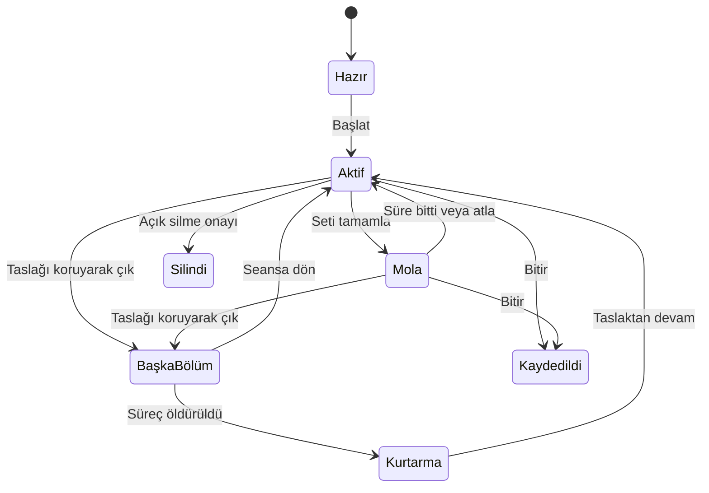

# Bilgi mimarisi ve bağlamsal ürün davranışı

18 Ekim 2026 · kaynak `07104d1` · üretim değişikliği yok. Öneriler [39 rota denetimi](02_CURRENT_STATE_AUDIT.md) ve [A–E yolculukları](04_USER_JOURNEYS.md) üzerine kuruludur. Kullanıcıların zihinsel modeli hakkında görüşme yapılmadı; aşağıdaki mimariler ağaç testi ve prototip adaylarıdır.

## Karar özeti

**Öneri:** dört ana sekmeyi koru; Home'u “Bugün” odaklı görev yüzeyi yap; mevcut İlerleme'yi antrenman ve vücut ilerlemesinin ortak girişine dönüştürmeyi test et; aktif seansı sekmelerin üstünde bağımsız bir çalışma bağlamı olarak tasarla. Yeni Koç/Asistan veya ayrı Ekle ana sekmesi gerekmiyor. En büyük değer tab sayısını değiştirmekten değil doğru anda doğru göreve erişmekten gelir.

Bu yönün en küçük, geri alınabilir parçası U03 hedef bağlantısı, U02 seans önceliği ve U09 Programlar bağlantısıdır. U01 aktif oturum sahipliği daha geniş teknik tasarım ister. Henüz uygulama onayı yok; kaynak, veri veya rota değiştirilmedi.

## Mevcut yapı

```text
Hesap/sürüm kapısı
├─ Karşılama → Giriş/Kayıt → Kurtarma
├─ Hesap hatası / hesap çakışması / zorunlu güncelleme
└─ İlk kurulum (4 iç sayfa)
   └─ 4 canlı ana dal
      ├─ Ana Sayfa
      │  ├─ Profil → Ayarlar / Hesap
      │  ├─ Hafta şeridi → gün paneli / genel ay takvimi
      │  ├─ Sıradaki rutin / devam → kök seans rotası
      │  ├─ Öğünler → ekleme paneli
      │  ├─ Ritim / Haftan hazır → haftalık değerlendirme
      │  ├─ Verime sor → asistan
      │  └─ Adım → izin / son 7 gün / hedef paneli
      ├─ Antrenman
      │  ├─ Rutinler → önizleme → başlat / düzenle / arşivle
      │  ├─ Boş antrenman → aktif seans
      │  ├─ Keşfet → hazır program → kur
      │  ├─ Son seanslar / geçmiş → seans ayrıntısı
      │  ├─ Antrenman takvimi → gün → geçmiş kayıt
      │  └─ Hareket kütüphanesi → yöntem / geçmiş / grafik / rekor
      ├─ Beslenme
      │  ├─ Tarih / özet / dört öğün / gün tamam
      │  ├─ Sabit yemek ekle / barkod → ekleme ve porsiyon
      │  └─ Geçmişten kopyala / dünü kopyala
      └─ İlerleme
         ├─ Aktivite ızgarası
         ├─ Fotoğraf → seç / karşılaştır
         └─ Ölçüm özeti / kilo grafiği / ölçüm listesi / ekle

Kök seans: aktif / rutinden / taslaktan / geçmiş kayıt
└─ Seans özeti
```

Kaynak: `lib/core/router/app_router.dart:135`, `:183–340`; `home/home_screen.dart:76`; `workout/workout_list_screen.dart:48`; `body_metrics/body_metrics_screen.dart:76`. Shell canlı durumu korur; detayların kök navigator'da açılması ana gezinmeyi örter. Bu kurgu detay için anlaşılır; uzun süren seans için bağlamlar arası dolaşmayı sınırlar (U01).

### Yapısal zayıflıklar

| Gerçek gözlem | Zihinsel model riski / çıkarım | Değişim ilkesi |
|---|---|---|
| İlerleme çoğunlukla vücut, kuvvet grafikleri kütüphanede | “Güçlendim mi?” sorusu beklenen yerde cevaplanmayabilir (U05) | Bölüm adı ile kapsamı eşleştir; test etmeden yeniden adlandırma |
| Home hem günlük, seans, ilk hafta, haftalık özet, ritim, asistan, sağlık | Kullanıcı önceliğini içerik bolluğu belirleyebilir (U11) | Tek birincil eylem, en çok iki ilgili bilgi satırı; geri kalanı kendi bölümünde |
| Genel ay ve antrenman ayı ayrı, Beslenme ayrıca tarih tutar | Geçmiş gün bağlamı geçişte kaybolabilir (U06) | Ortak tarih sözleşmesi ve alana özel içerik; tüm takvimleri zorla birleştirme |
| Aktif seans ana sekmeleri örter, geri onayı taslağı siler | Kayıtlarını koruyarak başka görev yapmak zorlaşır (U01) | Seans devam ederken gezinme ve görünür dönüş |
| Hedef düzenleme Profil, Beslenme bağlantısı Ayarlar | Etiket ve hedef uyuşmazlığı (U03) | Görev için gerçek hedefe doğrudan bağ |
| Keşfet rutinlerden sonra | Çok rutinli kullanıcıda program keşfi liste uzunluğuna bağımlı (U09) | Başlık düzeyinde ikincil Programlar erişimi |

## Üç bağımsız gezinme alternatifi

### A — Dört bölüm, bağlamsal Bugün

**Ana gezinme:** Bugün · Antrenman · Beslenme · İlerleme. Profil mevcut üst erişimde; Ayarlar/Hesap profil altında. Bugün görev, diğerleri çalışma alanıdır. İlerleme içinde Genel/Antrenman/Vücut ikincil ayrımı test edilir. Aktif seans dönüş satırı tüm ana bölümlerde görünür.

**Avantaj:** mevcut öğrenmeyi ve `StatefulShellRoute` dal sürekliliğini korur. Günlük kayıtlar sekmesinde kalır; yeni merkezî menü her göreve bir karar eklemez. **Risk:** Bugün ile Genel ilerleme tekrar edebilir; İlerleme ikinci seviye seçim gerektirir. **Teknik:** çoğu mevcut provider ve ekran kullanılabilir; aktif oturum ömrü ayrıca tasarlanır. **En güçlü gerekçe:** mevcut ürün zaten dört güçlü görev alanına sahip, eksik olan tutarlı girişlerdir.

### B — Dört bölüm, kayıt yerine plan/performans ayrımı

**Ana gezinme:** Bugün · Plan · Günlük · İlerleme. Plan rutinler/programlar; Günlük antrenman ve beslenme kayıtlarına ortak zaman çizgisi ve ekle eylemi. Canlı seans Plan'dan başlar ama kaydı Günlük'te görünür. Ayar/hesap yine profil.

**Avantaj:** geçmişin tek zaman ekseni; tarih taşınması doğal. Program kurmak ile kaydetmek ayrışır. **Risk:** günlük öğün eklemek artık “Günlük” içinde ikinci kategori seçebilir; Antrenman adına alışkın kullanıcı Plan altında başlamayı bulamayabilir. Günlük, besin ve set gibi çok farklı yoğunlukları tek yüzeye taşır. **Teknik:** ortak tarih bağlamı ve çok sayıda mevcut bağlantı değişir; veri şeması zorunlu değil ama regresyon yüzeyi geniş. **Ne zaman üstün olur:** araştırmada karma günlük içinde geçmiş arama ana iş çıkarsa, kayıtlar arası geçiş çoğunlukla geçmiş gün odaklıysa. Şu an bu kullanım sıklığı kanıtlanmadı.

### C — Beş bölüm, ayrı ilerleme ve kişisel alan

**Ana gezinme:** Bugün · Antrenman · Beslenme · İlerleme · Ben. Ben profil/ayar/sağlık/hesap. İlerleme baştan bütünsel. Aktif seans satırı ayrıca görünür; tab içinde ortada ayrı “+” kullanılmaz.

**Avantaj:** hesap/tercihler açık etiketle bulunabilir; ana sayfa başlığında küçük profil simgesine bağımlılık azalır. **Risk:** düşük sıklıktaki Ben her gün yatay yer harcar; dar/büyük yazıda 5 etiket sıkışır. Yeni sekme U01/U03 sorunlarını tek başına çözmez. **Teknik:** beşinci shell dalı, seçili durum/geri geçmişi ve dar ekran testi; orta maliyet. **Ne zaman üstün olur:** gerçek kullanıcıların profil/hedef/sağlık yönetimi çok sık ve bulunamıyor olduğu doğrulanırsa. Şu an araştırma bunu göstermedi.

| Karşılaştırma, 1 düşük – 5 yüksek | A: 4 bölüm / bağlamsal | B: Plan + Günlük | C: 5 bölüm / Ben |
|---|---:|---:|---:|
| Beklenen görev etkisi | 5 | 4 | 3 |
| Kullanılabilirlik kazancı | 5 | 3 | 4 |
| Görsel açıklık | 4 | 4 | 3 |
| Etkilenen kullanım sıklığı | 5 | 4 | 2 |
| Ayrışma potansiyeli | 4 | 4 | 2 |
| Uygulama karmaşıklığı (yüksek zor) | 3 | 5 | 3 |
| Regresyon/öğrenme riski (yüksek kötü) | 2 | 4 | 3 |
| Kanıt güveni | 4 | 2 | 2 |

Bu sayılar tasarımcı tahminidir; anket sonucu, ölçülmüş başarı veya toplam puan değildir. Yüksek karmaşıklık ve risk olumsuzdur. A'nın güveni de sınırlıdır: repo kanıtı güçlü, kullanıcı zihinsel modeli henüz ölçülmedi. Farkların gerçekten olup olmadığını aynı 8 bulma göreviyle ağaç testi belirler.

## Önerilen yapı A'nın ayrıntısı

| Bölüm | Birincil iş | Kalıcı görünür | İkincil / istek anında | Kesişme kuralı |
|---|---|---|---|---|
| Bugün | Sonraki faydalı eylemi seç | Gün bağlamı + en önemli görev + kısa gün özeti | Haftalık odak, ilk hafta rehberi, sağlık ayrıntısı | Görev ilgili çalışma alanını doğru gün/öğünle açar |
| Antrenman | Program seç/uygula | Rutinler, belirgin Başlat, Programlar/Geçmiş | Kurucu, kütüphane, arşiv | Süren seans varsa yeni seans birincil olamaz |
| Beslenme | Yemek kaydet/düzelt | Seçili gün, toplam/kalan, dört öğün, kalıcı Ekle | Arama/porsiyon/kopyalama, besin yönetimi | Home girişleri her zaman bugün; geçmiş açık tarih taşır |
| İlerleme | Anlamlı değişimi kanıtıyla gör | Dönem/kapsam; veri yeterliği | Hareket grafiği, rekor, fotoğraf, ölçüm, kaynak | Günlük tek sayıyı uzun dönem sonuç gibi sunma |
| Profil | Hedef/kimlik/hesap | Hedefler ve mevcut değerler | Tercihler, senkron, sağlık, gizlilik | “Hedefler” her alandan aynı düzenleyiciye gider |

### Bugün hiyerarşisi: görev → kanıt → ayrıntı

1. **Dar, sabit başlık:** tarih/gün bağlamı; profil ve gerekirse takvim. Ekranı dekoratif karşılama ile harcama.
2. **Görev alanı:** aşağıdaki öncelik tablosundan tek birincil eylem. Aktif seans varsa önce dön; başka sağlık/kalori çağrısı bunu bastırmaz.
3. **İlgili iki satır:** mevcut günlük antrenman/beslenme hesapları; verisi yoksa sayı uydurma. Her satır ilgili eyleme gider.
4. **Günlük kayıt özeti:** öğünler ve gerekliyse sağlık kısa satırı. Aktif seans durumunda kompakt kalabilir.
5. **Dönemsel fayda:** haftalık odak/ritim ve isteğe bağlı “Verime sor”. Her hafta yeni bir zorunlu görev üretme.

Bu yapı renk/tema seçimi değildir. Üç sanat yönü de aynı görev sözleşmesini kullanabilir; böylece görsel kıyas bilgi mimarisi değişiminden ayrılır.

### Belirlenimci bağlam kuralları

| Öncelik / koşul | Birincil yüzey ve eylem | İkincil içerik | Önleme / korunacak davranış |
|---|---|---|---|
| 0 Hesap/sürüm kapısı | İlgili güvenli kapı | Açık neden ve kurtarma eylemi | Kişisel veriyi kapıdan önce gösterme; yönlendirme UX uğruna aşılmaz |
| 1 Aktif taslak yükleniyor | Sessizce yeni Başlat sunmayan kısa iskelet | Gün özeti okunabilir | Taslak kararından önce iki seans yarışı yaratma |
| 2 Aktif seans / mola | “Seansa dön · hareket/set · mola kalan” | Beslenme küçük eylem, haftalık kart aşağıda | Yeni Başlat aynı ağırlıkta yarışmaz; süre sadece estetik için sıfırlanmaz |
| 3 İlk 14 gün, ilk antrenman yok | Hazır sıradaki antrenman veya program seçimi | Mevcut üç adımlı rehber; öğün/kilo tamamlananları tekrar görev yapma | docs/49 davranışı korunur; eski hesap yeni cihazda yeni kullanıcı sayılmaz |
| 4 Bugüne planlı rutin, yapılmadı | “Bugünkü antrenman · Başlat” | Mevcut açıklanabilir ilerleme satırı | Kendiliğinden ağırlık/program değişmez; önizleme erişimi açık |
| 5 Günlere bağlı olmayan rutin | “Sıradaki · rutin adı” | Tahmini süre ve ilgili öneri | `rotationNext` mevcut döngüsü; yapay “bugün kaçırdın” yok |
| 6 Planlı dinlenme | “Bugün dinlenme” bilgi; isteğe bağlı rutinler | Günlük kayıt ve dönemsel ilerleme | Boş ekranı doldurmak için ek seans baskısı yapma |
| 7 Antrenman bugün bitmiş | “Seans kaydedildi · özetini gör” | Açık günlük kayıt ihtiyacı varsa Ekle | Aynı rutini tekrar başlatmayı ana eylem yapma; tekrar antrenman ikincil kalabilir |
| 8 Öğün kaydı yok | “Öğün ekle” | Günün öğününe makul varsayılan, kullanıcı değiştirebilir | “Hiç yemedin” çıkarımı yok; sadece kayıt yok |
| 9 Kayıtlar var, hedefe kalan var | Kısa kcal/protein bilgisi, ekleme erişimi | Beslenme günlüğü | Sağlık tavsiyesi veya zorunlu telafi egzersizi üretme |
| 10 Gün kaydı tamam | Sakin tamamlandı bilgisi; geçmiş/ilerleme açık | İsteğe bağlı haftalık odak | Yeni ödül döngüsü/seri koruma baskısı yok; uygulamayı kapatmak başarılı sonuç olabilir |
| 11 Yeterli geçmiş yok | “Karşılaştırma için henüz kayıt yok” + mevcut ilk eylem | Yöntem/kapsam açıklaması | 0, bilinmiyor ve az veri ayrı; kişisel skor uydurma |

Çakışma kuralı: daha üst güven/seans durumu baskındır; haftalık/ilk hafta/tavsiye aynı anda üç birincil kart üretmez. Ekrandaki bölüm konumları sabit kalır, sadece görev içeriği değişir. Gün saati içerik için yardımcıdır, tek başına antrenman planı kararı değildir. Kaynaklar: `home/home_screen.dart:188`, `home/first_week.dart:29`, `home/today_lines.dart:116`, `home/week_ready.dart:29`, `workout/routine_providers.dart:54`.

### Aktif seans dönüşü ve navigasyon sözleşmesi



Mevcut “taslaktan kurtarma” ile önerilen “seans çalışırken bölümler arasında dolaşma” aynı özellik değildir. U01'in teknik kabul sınırı: seansın, mola sesinin ve canlı sistem kartının tek sahibi olacak; yeni widget her girişte yeni canlı kart başlatmayacak; mevcut bitiş anı korunacak; hesap değişimi önceki taslağa erişim vermeyecek. Veri kaydı/silme, çoklu yazım transaction'ı ve mevcut AppRoutes sözleşmeleri korunur. Burada üretim kodu tasarımı veya şema kararı verilmedi.

### Ayarlar ve kişiselleştirme

Mevcut Profil → Ayarlar ayrımını korumak düşük maliyetlidir: **Profil** kişiye ait hedefler/ölçüler/kimlik/hesap; **Ayarlar** tema/dil/birim/bildirim ve sağlık izinleri; **Veri güveni** Profil Hesap'ta senkron ve çıkış. Her ekrandan Ayarlar'a “her şeyi çöz” bağlantısı vermek yerine ilgili görevin gerçek düzenleyicisini aç. Destek/gizlilik/h hesap silme, bulunduğu yerin görünür etiketleriyle erişilebilir kalsın. Geliştirici kalite paneli kullanıcı ana mimarisine alınmaz.

## Büyük önerilerin puanları

1 düşük, 5 yüksek; tüm değerler 18 Ekim araştırma tahmini. Etki = kullanıcı yararı; kullanım = tekrar sıklığı; görsel = netlik/algılanan kalite kazancı; ayrışma = ayırt edici değer; karmaşıklık/risk büyüdükçe maliyet artar; güven = kanıtın öneriyi desteklemesi. Ölçülmüş sıklık veya kullanıcı memnuniyeti verisi yok.

| Öneri / bulgu | Etki | Kullanılabilirlik | Görsel | Kullanım | Ayrışma | Karmaşıklık | Risk | Güven |
|---|---:|---:|---:|---:|---:|---:|---:|---:|
| Hedefler bağlantısı gerçek Profil'e, U03 | 4 | 5 | 1 | 3 | 1 | 1 | 1 | 5 |
| ✓/± gerçek hedeflerini büyüt, U04 | 5 | 5 | 3 | 5 | 2 | 2 | 2 | 5 |
| Aktif seansı ilk sıraya getir, U02 | 5 | 5 | 4 | 5 | 3 | 2 | 2 | 4 |
| Taslağı koruyarak dolaşma + dönüş, U01 | 5 | 5 | 3 | 4 | 4 | 4 | 5 | 4 |
| 4 sekme + bağlamsal Bugün, A/U11 | 5 | 5 | 5 | 5 | 4 | 3 | 3 | 4 |
| Bütünsel İlerleme, U05 | 4 | 4 | 4 | 3 | 4 | 3 | 3 | 3 |
| Gün bağlamlı geçmiş bağlantıları, U06 | 4 | 4 | 2 | 3 | 3 | 3 | 3 | 4 |
| Doğrudan rutin Başlat, U08 | 4 | 4 | 3 | 5 | 2 | 2 | 3 | 3 |
| Başlıkta Programlar erişimi, U09 | 3 | 4 | 2 | 2 | 1 | 1 | 1 | 4 |
| Toplam hatasında açık tekrar dene, U07 | 4 | 4 | 2 | 2 | 2 | 1 | 1 | 5 |
| Bildirim seyrekliği/kontrol, U10 | 4 | 4 | 2 | 3 | 3 | 3 | 3 | 3 |

Puanlar toplanıp sahte kesinlik üretmez. U01 değerli ama en riskli; U03 basit ve çok güvenli. Ağaç testi U05'i çürütürse kapsamlı hub yapılmamalı. U08 yanlış başlangıç yaratırsa preview varsayılanı korunabilir.

## Doğrulama ve karar kapısı

Önce 8 görevli mimari testi: ilk antrenmanı başlat; hazır programı değiştir; bugünün öğle öğününü kaydet; geçen salının yemeğini bul; bench grafiğini bul; son kilonu gör; hedef proteini değiştir; bildirimleri seyrekleştir. A/B/C'yi görsel maketlerden bağımsız ağaçlarda karşılaştır. Sonra en iyi iki mimarinin aynı üç çekirdek ekranını aynı görev/veriyle karşılaştır; başarı, ilk doğru seçim, süre, hata, güven ve tek el erişim ölç. Yeni sekme sayısına veya daha çok kart tıklanmasına göre karar verme.

U01 uygulamasından önce CONVENTIONS §7b gereği oturum verisinin sahipliği/yaşam süresi için ayrı kısa karar özeti ve regresyon matrisi gerekir. Bu rapor uygulama onayı sayılmaz. Nihai sıra ve görsel yön kullanıcı onayından sonra geliştirme planına dönüştürülür.
