# A7 — K4: Aktif seans set satırı, 48×48 hedefler ve dar ekran

Kaynak anı: `main` = `07104d1`. Renderlar gerçek Flutter widget testiyle
(gerçek tema, Plus Jakarta Sans, Material/Phosphor ikon fontları) scratch
worktree'de üretildi; worktree silindi, commit yok.

## Karar özeti

1. **Rapor 12 §3.6'daki satır tarifi kodla uyuşmuyor.** ± satırın içinde değil;
   yalnız *aktif* setin altındaki ayrı "yardım satırında" duruyor (öneri metni +
   `−  2,5 kg  +`). Yani bugün aktif set zaten iki satır. (**K** `active_session_widgets.dart:462–472` çağrı, `:559–634` bileşen)
2. **Bugünkü 320 pt / 1,3× durum zaten bozuk:** kg alanı 38 pt genişlik; "60"
   "6(" diye kırpılıyor, aktif setin öneri ipucu hiç görünmüyor; başlıklar
   "ÖNCE/Kİ", "TEKR/AR" diye bölünüyor; mola kartı "Dinlen/me 1:1/5". (**G** render)
3. **393 / 1,6× EN'de bugün de taşma var:** RPE başlığı (`_RpeHeader`, 44 pt
   kutu) 5,9 pt sağdan taşıyor — üç seçenekte de aynı, K4'ten bağımsız hata. (**G** render + test istisnası, **K** `:913–936`)
4. **Seçenek 1 (± satırda, 48×48):** 393'te her set satırı 50 → 58 pt (+%16),
   aktif set bloğu 88 → 114 pt; ilk kart 411 → 461 pt; ekranda tam görünen set
   5 → 4. 320'de kg alanı 38 → **33 pt**'ye düşüyor (daha kötü).
5. **Seçenek 2 (± panelde):** satır yine 58 pt, ama aktif set bloğu 88 → 83 pt;
   ilk kart 430 pt. 393'te en kompakt 48'li seçenek. **320 / 1,3×'te en kötüsü:**
   33 pt'lik dokunma hücresinde "60" alt alta kırılıyor ("6/0"), satır 88 pt'ye
   çıkıyor, görünen set 3 → 2.
6. **Asıl dar ekran düğümü ± değil, "ÖNCEKİ" sütunu (56 pt).** Kardeş incelemenin
   önerdiği varyant (Seçenek 1b: ÖNCEKİ dar ekranda satırdan çıkar, aktif setin
   yardım satırına yazılır) 320'de kg alanını 33 → **61 pt**'ye çıkarıyor; "60" ve
   "62.5" okunur, satır 58 pt.
7. **Sık düzenleme dokunuş sayısı:** +2,5 kg — Seçenek 1: 1 dokunuş, Seçenek 2: 3
   dokunuş (hücre → + → Tamam), testte doğrulandı. −1 tekrar — Seçenek 1: alana
   dokun + klavye + kapat; Seçenek 2: 3 dokunuş, klavyesiz (testte 8 → 7).
8. **Öneri:** Faz 1'de **Seçenek 1 + 1b** (± aktif setin yardım satırında 48×48;
   genişlik < 360 pt'de ÖNCEKİ sütunu yardım satırına taşınır). Seçenek 2'nin
   paneli atılmasın: kg/tekrar hücresine **uzun basma** ya da 2. faz
   "tekrar ±" ihtiyacı için ek yol olarak düşünülsün (H).
9. Üç seçenekte de 48'in altında kalan hedefler var (set no rozeti 30×32, RPE
   38×36, dinlenme çipi 59×21, ? düğmesi 40×40, mola −15/+15 49×31). K4 tek
   başına "tüm özel hedefler ≥48" kabul ölçütünü karşılamaz.

## Yöntem ve sınırlar

- `git worktree add --detach <scratchpad>/k4 main` → worktree'de
  `lib/features/workout/active_session_widgets.dart` kopyasına `k4Variant`
  bayrağı eklendi (0 = bugünkü, 1 = Seçenek 1, 2 = Seçenek 2, 3 = Seçenek 1b) ve
  `test/k4_render_test.dart` yazıldı. Tam fark: [`k4/deney.diff.txt`](k4/deney.diff.txt).
  Ana depoda `lib/`/`test/` değişmedi; worktree `git worktree remove --force` ile silindi.
- Render yaklaşımı `test/features/neon_design_test.dart`'tan alındı:
  `RepaintBoundary.toImage`, `GoogleFonts.pendingFonts()`, `FontLoader` ile
  MaterialIcons + Phosphor, `AppTheme.dark`, `GlassBackground`, `textScaler`.
- Ekran: gerçek `RestBanner`, `SessionDateBar`, `ExerciseBlock` (bugünkü kod);
  uygulama çubuğu `active_session_screen.dart:991–1056`'nın sadeleştirilmiş
  kopyası (aynı başlık/alt satır/Bitir düğmesi). Liste dolgusu ekranla aynı
  (`16,12,16,96`).
- Veri: Kart 1 "Barbell Bench Press" 4 set — 2 bitti (60×8, RPE 8), 1 aktif
  (önceki 60×8 → öneri "✓ ile 60 kg × 8"), 1 bekleyen (önceki 57,5×8). Kart 2
  "Incline Dumbbell Press" 3 bekleyen set (görünen set sayımı için). Dinlenme
  1:15, adım 2,5 kg.
- Senaryolar (hepsi koyu tema):
  - **A:** 393×852, @3x, TR, 1,0×; güvenli alan üst 59 / alt 34 (iPhone 15/16 sınıfı).
  - **B:** 320×568, @3x, TR, 1,3×; güvenli alan üst 20 / alt 0. Yükseklik
    **varsayım** (iPhone SE 1. nesil); "görünen set" sayısı bu varsayıma bağlı.
  - **C:** 393×852, @3x, EN, 1,6×.
- Ölçüm: `tester.getSize` ile her dokunulabilir öğenin `InkWell`/`TextField`
  kutusu, set satırı `Container`'ı, yardım satırı, kart yüksekliği; "görünen set"
  = liste başındayken üstü listenin üstünde, altı `ekran − alt güvenli alan`
  çizgisinin üstünde kalan set satırı sayısı (klavye kapalı).
- Dokunuş sayıları: +2,5 kg (her seçenek) ve −1 tekrar (Seçenek 2) testte
  gerçek `tap` ile yapılıp değer kontrol edildi (60 → 62,5; 8 → 7). Klavyeli
  yollar koddan sayıldı (**K**) — klavye testte açılmıyor.
- **Sınırlar:**
  - Öneri metnindeki "✓" karakteri renderlarda "≣" görünüyor: test ortamında
    Plus Jakarta Sans'ta olmayan glifler için sistem yedek fontu yok. Cihazda
    görünmez (**H**, test yapıntısı).
  - Seçenek 2 paneli prototip: "yazmak için dokun" alanı bağlı değil (klavye
    açmıyor); hücre metni üstten hizalı (görsel kusur, kavramı etkilemez).
  - Gerçek cihazda tek el / eldiven / ter denemesi yapılmadı; erişilebilirlik
    okuyucusu (TalkBack/VoiceOver) denenmedi.
  - Seçenek 1'de satırı ikiye bölme kuralı (ipucu üstte, ± altta) bir eşikle
    yazıldı: `genişlik − (96 + 8 + 40×ölçek) < 140×ölçek`. Başka eşik başka sonuç verir.

## Görseller

| Senaryo | Bugünkü | Seçenek 1 | Seçenek 2 | Seçenek 2 paneli |
|---|---|---|---|---|
| 393 TR 1,0× | 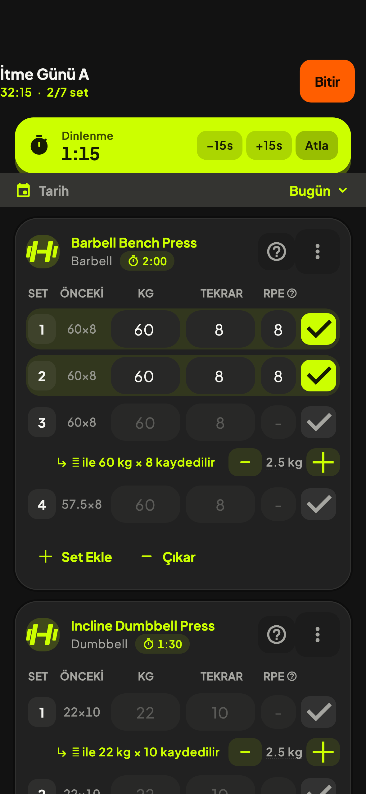 |  | 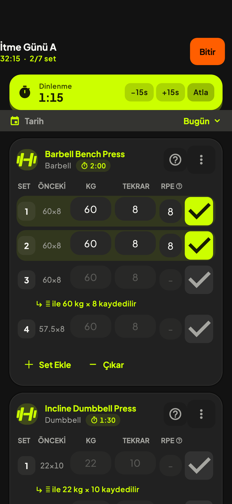 | 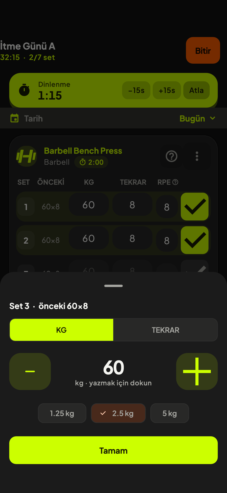 |
| 320 TR 1,3× | 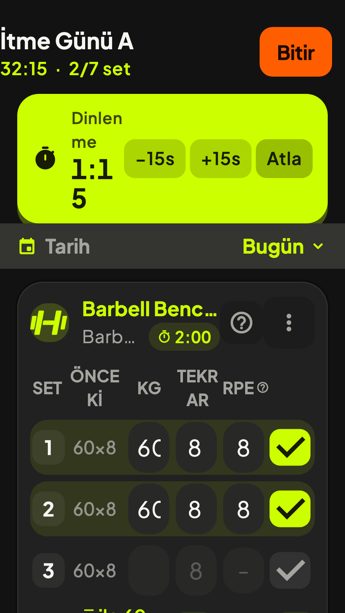 | 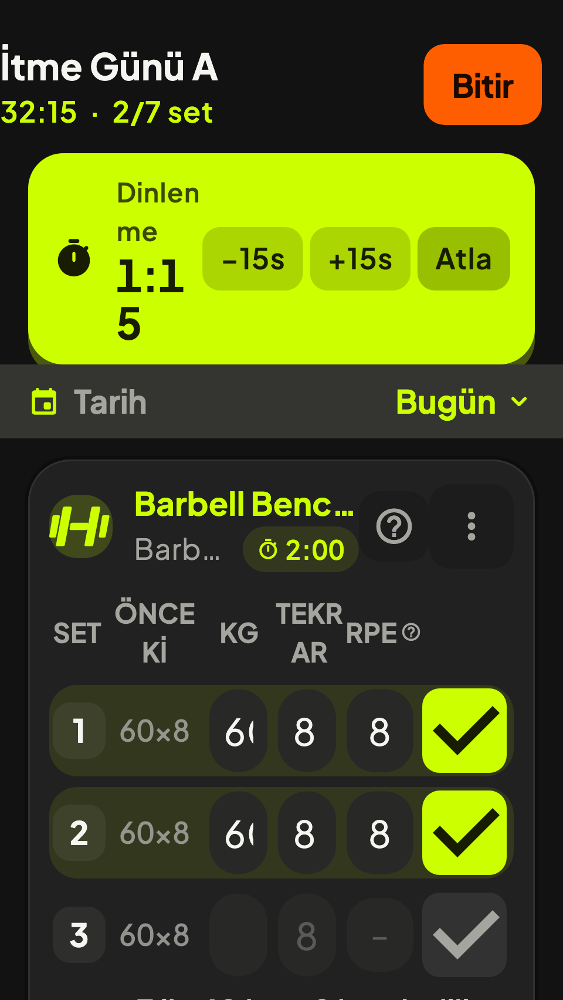 | 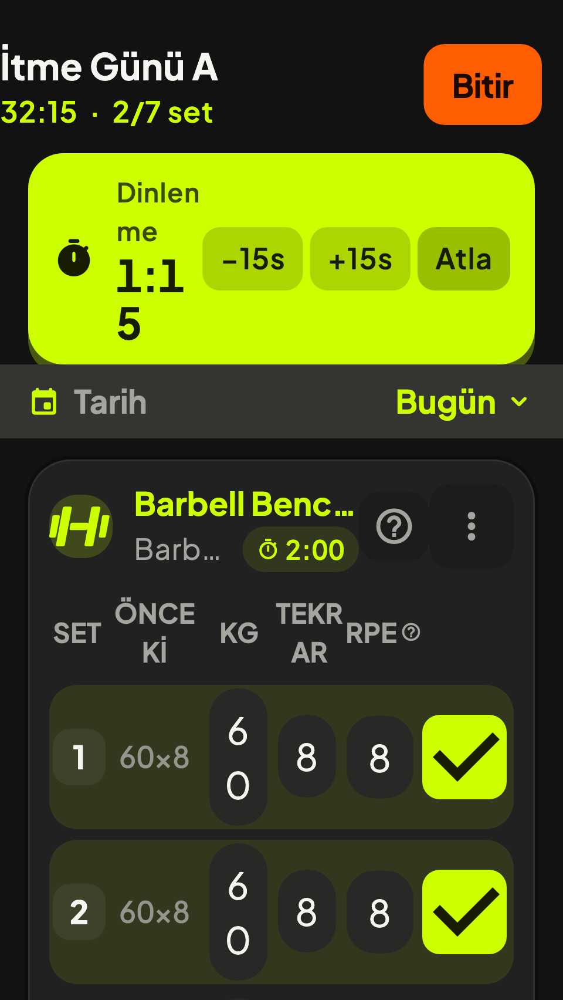 | 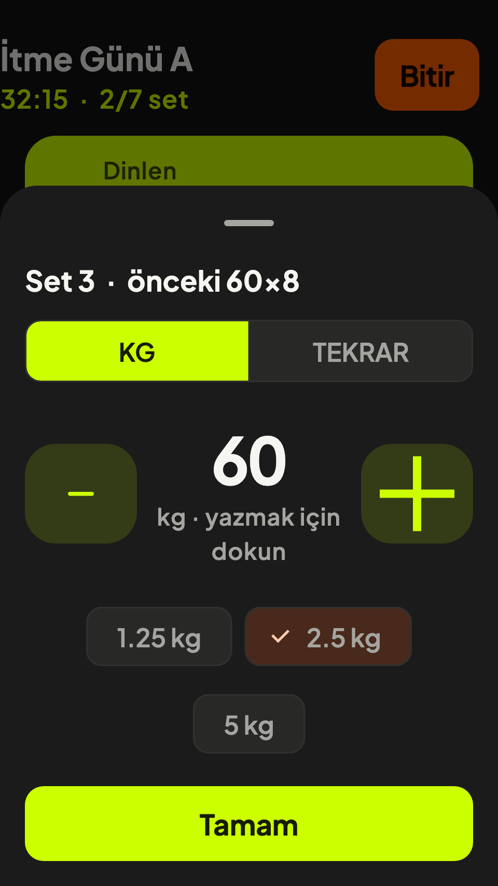 |
| 393 EN 1,6× | 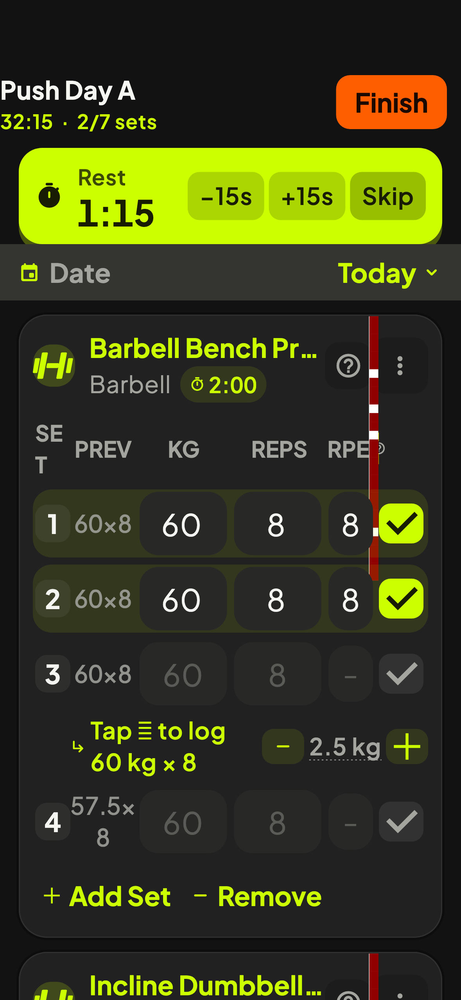 | 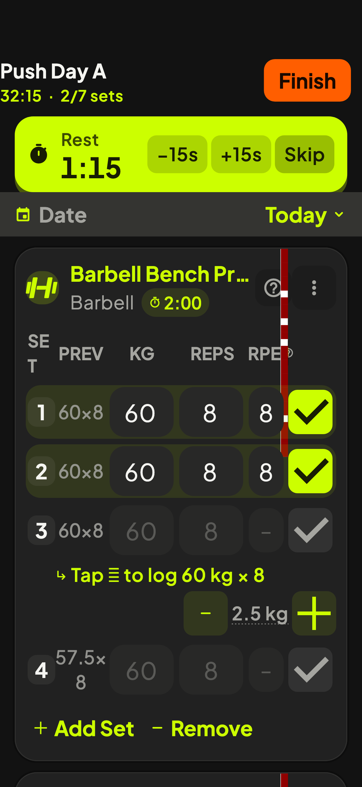 | 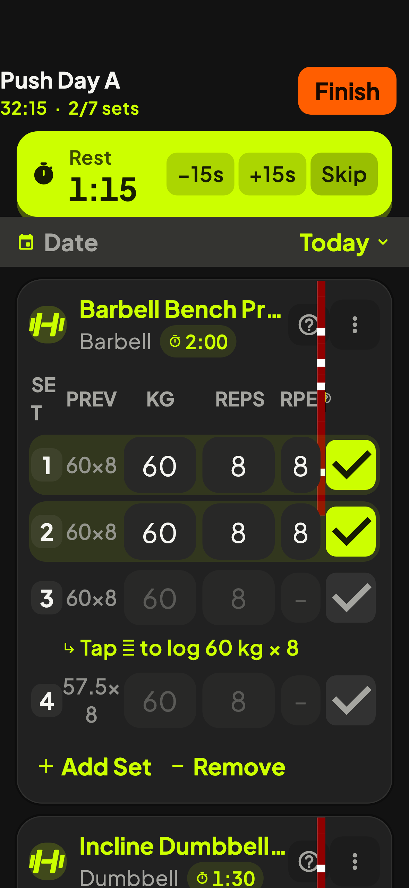 | 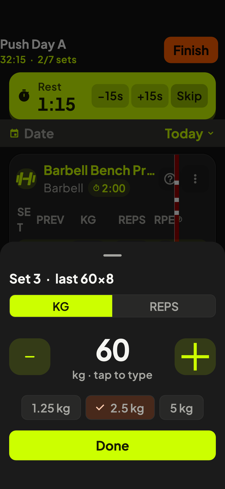 |

Aktif set ortalanmış hâli (+2,5 kg uygulandıktan sonra; 320'de kıvrım altında kalan yardım satırını gösterir):

| Senaryo | Bugünkü | Seçenek 1 | Seçenek 1b (ÖNCEKİ satır dışı) |
|---|---|---|---|
| 393 TR 1,0× | 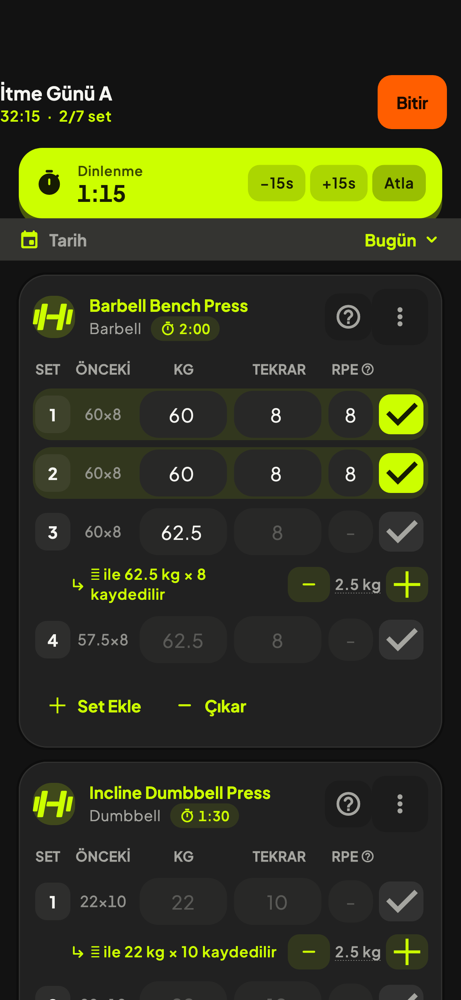 | 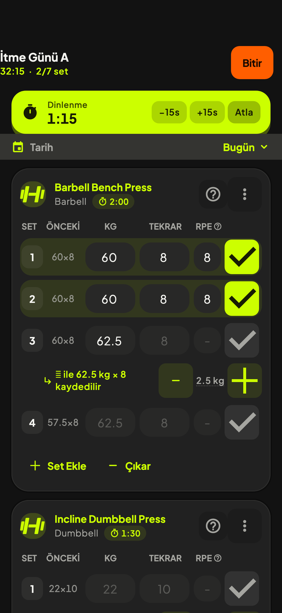 | — (393'te 1b = 1) |
| 320 TR 1,3× | 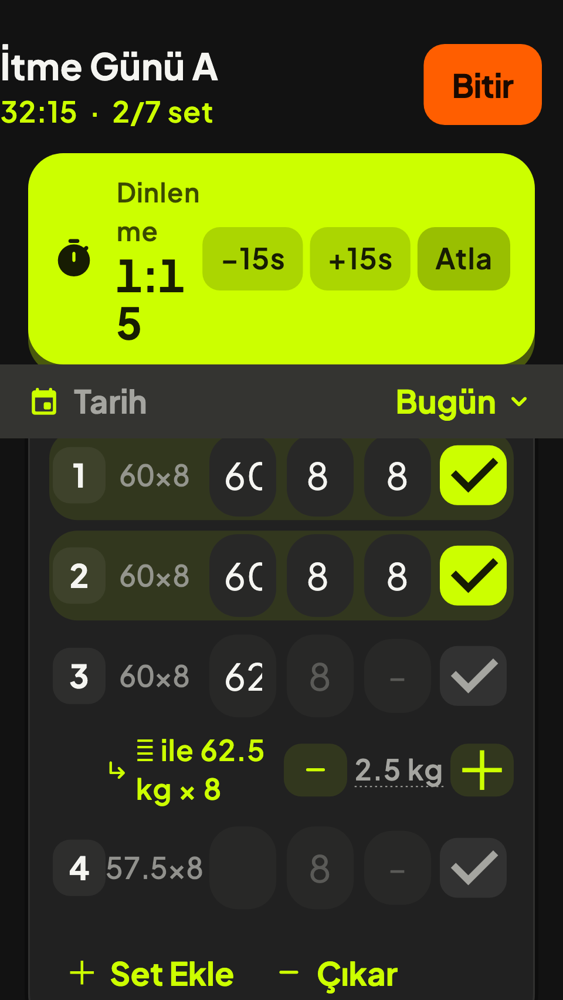 | 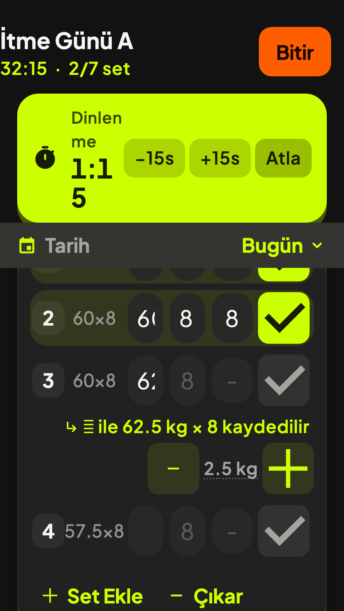 | 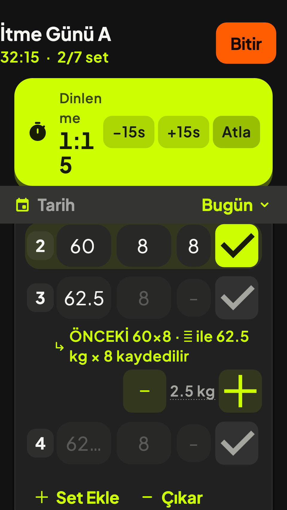 · tam ekran: 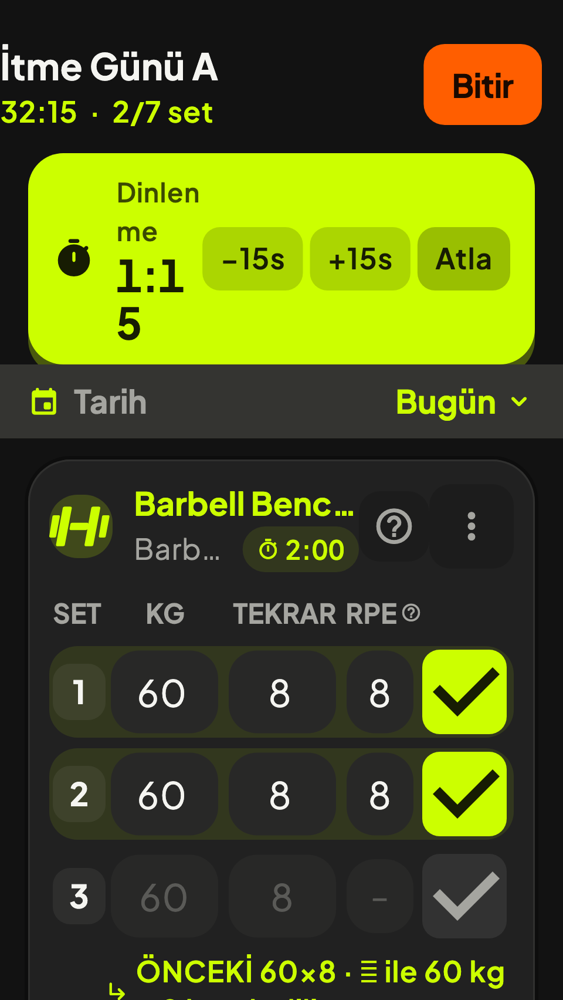 |
| 393 EN 1,6× | 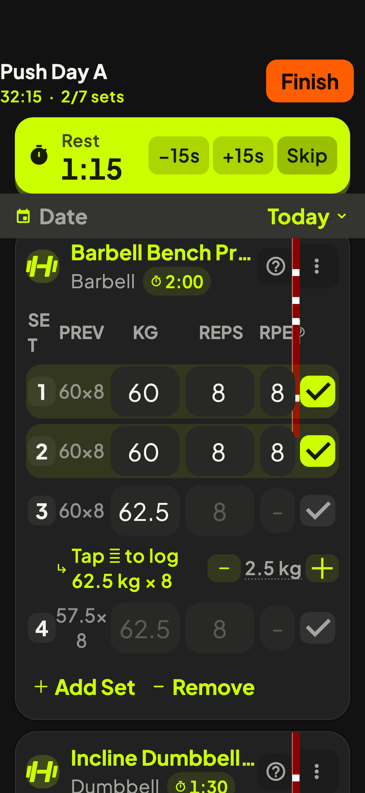 | 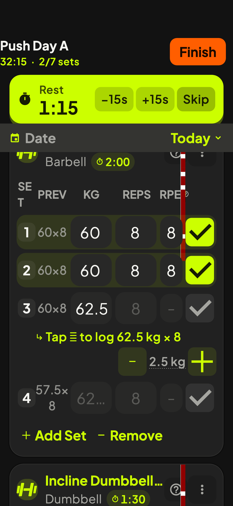 | — |

Ham ölçümler: [`k4/olcumler.json`](k4/olcumler.json).

## Bulgular

### 1. Yükseklik ve ekrana sığan set sayısı (G, ölçüm)

"Satır" = tek set satırı (dış boşluk dahil değil, +6 pt alt boşluk ayrı).
"Aktif blok" = aktif set satırı + altındaki yardım satırı.
"Görünen set" = ilk ekranda tam görünen set satırı / iki karttaki toplam set (7).

| Senaryo | Seçenek | Satır (pt) | Yardım satırı (pt) | Aktif blok (pt) | Kart 1 (pt) | Görünen set |
|---|---|---|---|---|---|---|
| 393 TR 1,0× | Bugünkü | 50 | 38 | 88 | 411 | **5** / 7 |
| | Seçenek 1 | 58 | 56 | 114 | 461 | 4 / 7 |
| | Seçenek 2 | 58 | 25 | 83 | 430 | 4 / 7 |
| 320 TR 1,3× (568 yük.) | Bugünkü | 57 | 52 | 109 | 484 | 3 / 7 |
| | Seçenek 1 | 58 | 82 (ikiye bölündü) | 140 | 518 | 3 / 7 |
| | Seçenek 1b | 58 | 104 (ÖNCEKİ + öneri + ±) | 162 | 518 | 3 / 7 |
| | Seçenek 2 | **86–88** ("6/0" kırılması) | 30 | 116 | 582 | **2** / 7 |
| 393 EN 1,6× | Bugünkü | 64 | 62 | 126 | 543 | 4 / 7 |
| | Seçenek 1 | 64 | 87 | 151 | 568 | 4 / 7 |
| | Seçenek 2 | 63–64 | 35 | 98 | 515 | 4 / 7 |

Not: 1,6×'te satırı zaten metin büyüklüğü belirliyor (64 pt), bu yüzden 48'lik ✓
yüksekliği eklemiyor. 1,0×'te 48 pt ✓ satırı 8 pt büyütüyor.

### 2. Dokunma alanları — aktif set (G, `tester.getSize`)

Genişlik × yükseklik, mantıksal pt. Kalın = 48'in altında.

| Öğe | 393 Bugünkü | 393 S1 | 393 S2 | 320 Bugünkü | 320 S1 | 320 S1b | 320 S2 | 1,6× Bugünkü | 1,6× S1 | 1,6× S2 |
|---|---|---|---|---|---|---|---|---|---|---|
| ✓ tamamla | **38×34** | 48×48 | 48×48 | **38×34** | 48×48 | 48×48 | 48×48 | **38×34** | 48×48 | 48×48 |
| − kilo | **36×30** | 48×48 | (panelde 72×64) | **36×30** | 48×48 | 48×48 | (72×64) | **36×30** | 48×48 | (72×64) |
| + kilo | **36×30** | 48×48 | (panelde 72×64) | **36×30** | 48×48 | 48×48 | (72×64) | **36×30** | 48×48 | (72×64) |
| Adım etiketi ("2,5 kg") | **48×25** | 48×48 | (çip 67–95×48) | **59×30** | 59×48 | 59×48 | (çip 72–108×48) | **70×35** | 70×48 | (çip 77–121×48) |
| kg alanı | 75×**40** | 70×**40** | 70×48 | **38**×**47** | **33**×**47** | 61×**47** | **33**×76 | 75×54 | 70×54 | 70×53 |
| tekrar alanı | 75×**40** | 70×**40** | 70×48 | **38**×**47** | **33**×**47** | 61×**47** | **33**×48 | 75×54 | 70×54 | 70×53 |
| RPE hücresi | **38×36** | **38×36** | **38×36** | **38×42** | **38×42** | **38×42** | **38×42** | **38**×48 | **38**×48 | **38**×48 |
| Set no / tip rozeti | **30×32** | **30×32** | **30×32** | **30×32** | **30×32** | **30×32** | **30×32** | **30×32** | **30×32** | **30×32** |
| Nasıl yapılır (?) | **40×40** | **40×40** | **40×40** | **40×40** | … | … | … | **40×40** | … | … |
| Dinlenme çipi (⏱ 2:00) | **59×21** | **59×21** | **59×21** | **66×26** | … | … | … | **74×31** | … | … |
| Mola −15s / +15s | **49×31** | **49×31** | **49×31** | **57×36** | … | … | … | **65×41** | … | … |
| Set ekle | 108×48 | 108×48 | 108×48 | 118×48 | … | … | … | 127×48 | … | … |

Seçenek 2 panelinin kendi hedefleri (393 TR): −/+ 72×64, değer alanı 217×64,
adım çipleri 84/95/67×48, KG/TEKRAR seçici 361×48, Tamam 361×48; panel yüksekliği
334 pt (1,6×'te 383, 320/1,3×'te 401 — 568'lik ekranın %71'i).

Kod karşılığı (**K**): ✓ `active_session_widgets.dart:1236–1243` (38×34);
± `_StepButton` `:655–656` (36×30); kg/tekrar `_NumCell` `contentPadding 8/4`,
`isDense` (`:1288–1292`); rozet `:1188–1192` (genişlik 30, yükseklik 32);
RPE `_RpeCell` 44 pt sütun − 6 pt dolgu (`:1059–1060`, `:1311–1312`); başlık sütunları `:430–440`.

### 3. 320 pt'de genişlik bütçesi (K + G)

Satırın içi 320 − 32 (liste) − 24 (kart) − 4 (satır) = **260 pt**. Sabit
sütunlar: rozet 30 + ÖNCEKİ 56 + RPE 44 + ✓ sütunu 42 = 172 → kg ve tekrar'a
44'er pt, dolgu sonrası **38 pt** (ölçülen 38). ✓ sütunu 52 olunca 33 pt
(ölçülen 33). ÖNCEKİ kaldırılınca 61 pt (ölçülen 61). 1,3×'te "60" ≈ 26–28 pt,
"62.5" ≈ 45 pt yer istiyor; 38 pt'de "60" kırpılıyor (bugünkü render), 61 pt'de
"62.5" sığıyor ama bekleyen setin soluk ipucu "62…" diye kesiliyor (S1b render).

Kardeş incelemenin "48'lik set/RPE/✓ ile kg/tekrar'a ~29 pt kalır" tespiti
doğrultusunda: rozeti ve RPE'yi de 48'e çıkarmak (+18 + 4) kg/tekrar'ı ~22 pt'ye
düşürür — **ÖNCEKİ satırda kalırsa 320'de 48'li tam satır mümkün değil** (K, hesap).

### 4. Sık düzenlemelerde dokunuş sayısı

Varsayım: aktif set, adım zaten 2,5 kg.

| Düzenleme | Bugünkü | Seçenek 1 / 1b | Seçenek 2 | Kanıt |
|---|---|---|---|---|
| +2,5 kg (aktif set) | 1 (36×30 hedef) | **1** (48×48) | 3: hücre → + → Tamam | G (testte 60 → 62,5) |
| +2,5 kg, adım farklıysa | 3: adım etiketi → seçici → + | 3 | 4: hücre → çip → + → Tamam | K |
| +2,5 kg (bitmiş ya da bekleyen set) | ± yok → alana dokun + sil + "62.5" yaz + kapat = 2 dokunuş + ~6 tuş | aynı | **3** (her sette panel) | K / G |
| −1 tekrar (alan boş, ipucu 8) | alana dokun + "7" + kapat = 2 dokunuş + 1 tuş | aynı | **3**, klavyesiz | G (S2: 8 → 7), K |
| −1 tekrar (alan dolu "8") | 2 dokunuş + 2 tuş (sil, 7) | aynı | 3 | K |
| Tam değer yaz (63,75 kg) | alana dokun + sil + 5 tuş + kapat = 2 dokunuş + ~7 tuş | aynı | hücre → değer → 5 tuş → Tamam = 3 dokunuş + ~7 tuş (prototipte bağlı değil) | K / H |

"Kapat" = klavyeyi kapatmak; iOS sayı klavyesinde dönüş tuşu yok, boş yere
dokunmak gerekir. ✓ kendisi `_dismissKeyboard()` çağırmıyor (`_toggleDone`
`active_session_screen.dart:598`), menü/seçici/± çağırıyor (`:671–762`) — yani
"değer yaz → ✓" akışında klavyenin kapanması ayrı bir dokunuş olabilir (**H**,
cihazda denenmedi).

### 5. Artılar / eksiler

**Seçenek 1 — ± satırda (aktif setin yardım satırında), 48×48**
- \+ En sık iş (+1 adım kilo) tek dokunuş kalıyor; mevcut kas hafızası korunuyor.
- \+ En az kod değişikliği: boyut + eşikli iki satıra bölme.
- − 393'te kart 50 pt uzuyor, görünen set 5 → 4.
- − 320'de kg/tekrar 33 pt'ye düşüyor — bugünkü kırpılma kötüleşir. Tek başına
  kabul edilemez.
- − Tekrar ± yok (bugün de yok); −1 tekrar hâlâ klavye.

**Seçenek 1b — Seçenek 1 + dar ekranda ÖNCEKİ satırdan çıkar**
- \+ 320'de kg/tekrar 61 pt; "60", "62.5" okunur; satır 58 pt.
- \+ Aktif sette "ÖNCEKİ 60×8 · ✓ ile 62.5 kg × 8 kaydedilir" tek cümlede.
- − Bitmiş/bekleyen setlerde dar ekranda "önceki" görünmez; bekleyen sette soluk
  ipucu (öneri) çoğunlukla aynı değeri taşıyor ama aynı şey değil (öneri
  ilerlemeyle değişebilir) (**K** `active_session_model.dart:142–160`).
- − Aktif blok 320'de 162 pt (3 satır).

**Seçenek 2 — ± panelde, hücreye dokununca adım paneli**
- \+ 393'te en kompakt 48'li düzen (aktif blok 83 pt, bugünden bile kısa).
- \+ Her sette ve hem kg hem tekrar için ± (−1 tekrar klavyesiz 3 dokunuş).
- \+ Panel hedefleri büyük (72×64), eldiven/terli el için uygun (**H**).
- − En sık iş 1 → 3 dokunuş; set başına ~2 ek dokunuş × günde 15–25 set (**H**).
- − Klavyeyle yazma bir adım geriye düşer; hızlı yazanı yavaşlatır.
- − 320/1,3×'te dokunma hücresi 33 pt — kırılıp satırı 88 pt'ye çıkarıyor; ÖNCEKİ
  sütunu çıkmadan dar ekran sorununu çözmez.
- − Panel 568'lik ekranın %71'i; hangi setin düzenlendiği üstte kısmen görünüyor.

## Öneri

Faz 1: **Seçenek 1 + 1b.**
1. ✓ 48×48 (sütun 52 pt), ± ve adım etiketi 48 pt yükseklik, aktif setin yardım
   satırında; yer yetmezse öneri üstte, ± altta.
2. Kullanılabilir satır genişliği < ~300 pt (pratikte ekran < 360 pt veya büyük
   metin) olduğunda ÖNCEKİ sütunu satırdan çıkar, aktif setin yardım satırına
   "ÖNCEKİ 60×8" olarak yazılır.
3. Rozet (30×32) ve RPE (38×36) için görünen boyutu büyütmeden dokunma alanını
   genişletmek (ör. dikeyde 48'e uzatmak) ayrı iş; ✓ ve ± ile aynı dilimde ölçülmeli.
4. `_RpeHeader` 1,6×'te taşıyor — K4'ten bağımsız düzeltilmeli.
5. Seçenek 2 paneli, Faz 2'de "tekrar ±" ya da hücreye uzun basma için
   değerlendirilsin; birincil yol olmasın (+2,5 kg 1 → 3 dokunuş).

Karar için cihaz denemesi: 393'te kartın 50 pt uzaması salonda rahatsız ediyor
mu (kaydırma), ve 320 sınıfında gerçek bir cihaz var mı — Samet'in iki cihazı
393 civarı; 320 hedefi yalnız erişilebilirlik ölçütü olarak kalabilir (**H**).

## Pakete etkisi

- **12 §3.6 ("set no · kg · ± · tekrar · ✓" satırı) — yanlış:** ± satırda değil,
  aktif setin altındaki ayrı satırda; satır bugün de aktif sette iki kat
  (K `:462–472`, `:559–634`; G render). "İki satıra geçer → her seti iki kat
  uzatır" ifadesi yalnız aktif set için geçerli; diğer setler 50 → 58 pt (+%16).
  Düzeltme: §3.6'yı bu ölçümlerle değiştir.
- **12 §3.6 alternatif (± panelde, ✓ 48) — kısmen:** 393'te en kompakt seçenek
  ama dar ekran sorununu çözmüyor (320'de 33 pt hücre, 88 pt satır). Asıl düğüm
  ÖNCEKİ sütunu. Düzeltme: K4'e "ÖNCEKİ dar ekranda satır dışı" seçeneğini ekle.
- **12 tablo U04 (✓ 38×34, ± 36×30) — güçlendi:** ölçümle aynı (G). Satır
  numaraları (`:1239–1240`, `:655–656`) doğru.
- **09 §Faz 1 madde 1 ("sayı girişleri küçültülmez") — bugünkü durumda zaten
  ihlal:** 320/1,3×'te kg 38 pt ve "60" kırpılıyor. 48'lik ✓ ile 33 pt'ye düşer.
  Düzeltme: kabul ölçütüne "320/1,3×'te kg alanı ≥ 56 pt" gibi ölçülebilir bir
  alt sınır ekle.
- **09 / 12 "tüm özel hedefler ≥48" kabul ölçütü:** K4 tek başına yetmez; rozet,
  RPE, dinlenme çipi, mola ±15 s, ? düğmesi 48 altında (G). Faz 1 kapsamına açık
  liste olarak yazılmalı.
- **Yeni bulgu:** `_RpeHeader` 1,6× metinde 5,9 pt taşıyor; mola kartı 320/1,3×'te
  "Dinlen/me 1:1/5" diye kırılıyor (G). Paket bu ikisini anmıyor.
